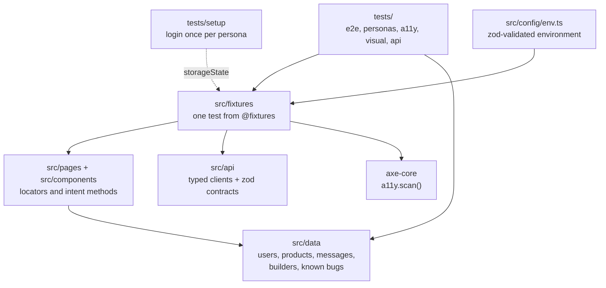
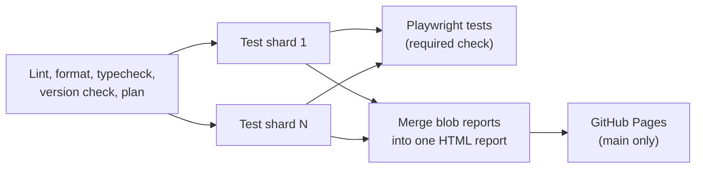

# SauceDemo Playwright AI

[](https://github.com/vukobrat/saucedemo-playwright-ai/actions/workflows/ci.yml)
[](https://github.com/vukobrat/saucedemo-playwright-ai/actions/workflows/docker.yml)
[](https://vukobrat.github.io/saucedemo-playwright-ai/)


[](LICENSE)

Production-grade test automation for [SauceDemo (Swag Labs)](https://www.saucedemo.com/) with Playwright and TypeScript: end-to-end, accessibility, visual regression and API tests, sharded CI with a published report, and a repository set up for AI coding agents.

**At a glance**

- 130 test cases, 306 runs per full regression (chromium, firefox, webkit) in 4 parallel shards of about 2 minutes each
- Page Object Model with components, typed fixtures, per-persona login via `storageState`
- 26 catalogued application defects, each asserted as an expected failure with a stable id
- Accessibility gate (axe, WCAG 2.2 AA) and visual regression with reviewed Linux baselines
- Typed API layer with runtime contracts (zod) against a public demo API
- Key conventions enforced by lint, git hooks and CI, not only written down

**Latest report:** https://vukobrat.github.io/saucedemo-playwright-ai/

## Contents

- [Architecture](#architecture)
- [Test strategy](#test-strategy)
- [Getting started](#getting-started)
- [Running tests](#running-tests)
- [Docker](#docker)
- [CI/CD](#cicd)
- [Conventions](#conventions)
- [Adding a test](#adding-a-test)
- [Agentic engineering](#agentic-engineering)
- [Project structure](#project-structure)

## Architecture



- **Specs own assertions; page objects own locators.** Pages expose `readonly` locators and intent methods such as `addToCart(product)`. The only assertion they contain is `expectLoaded()`, a navigation guard.
- **Components** (header, side menu, product card, cart item) are scoped to a root locator and reused across pages.
- **Fixtures** inject page objects, a seeded `faker`, the axe scanner and API clients. Specs import `test` and `expect` from `@fixtures` only.
- **Typed data** replaces magic strings: catalog prices in integer cents, verbatim UI messages, a `CustomerBuilder`, and expected values derived by functions (`sortProducts()`, `orderTotals()`), never copied from the screen.
- **Configuration** is read and validated in one place. Missing or invalid variables stop the run before a browser starts, with a message that names the variable.

## Test strategy

| Project                           | What                                                         | Browsers         | Runs on                          |
| --------------------------------- | ------------------------------------------------------------ | ---------------- | -------------------------------- |
| `setup`                           | Logs in each persona through the UI and saves `storageState` | chromium         | every run, every shard           |
| `chromium` / `firefox` / `webkit` | Functional e2e and persona specs                             | all three        | smoke on PRs, everything nightly |
| `a11y`                            | axe WCAG 2.0/2.1/2.2 A+AA, zero violations on 9 page states  | chromium         | every PR                         |
| `visual`                          | Screenshot comparison against Linux baselines                | bundled Chromium | every PR                         |
| `api`                             | DummyJSON auth, products and carts contracts                 | none (HTTP)      | nightly (third-party API)        |

**Tags:** `@smoke` (critical path), `@regression`, `@persona`, `@a11y`, `@visual`, `@api`. ESLint rejects tests without a tag or with an unknown one.

**Personas.** SauceDemo ships deliberately broken users. Each defect is catalogued in [`src/data/known-bugs.ts`](src/data/known-bugs.ts) with a stable id, and the test asserts the _correct_ behavior under `knownBug()`:

| Ids             | Area                                                                                       | Count |
| --------------- | ------------------------------------------------------------------------------------------ | ----- |
| SD-0xx          | standard user (stale buttons, cart accessible name, empty-cart checkout, whitespace names) | 4     |
| SD-1xx / SD-2xx | `problem_user` / `error_user` (images, sorting, cart, checkout)                            | 13    |
| SD-3xx          | `performance_glitch_user` (login and sort budgets)                                         | 2     |
| SD-4xx          | `visual_user` (random prices, broken image, layout)                                        | 3     |
| SD-5xx          | accessibility best practices                                                               | 2     |
| DJ-0xx          | DummyJSON API (500 instead of 401, inconsistent field names)                               | 2     |

The suite stays green while a bug exists and turns red when it is fixed, so markers cannot rot. `EXPOSE_KNOWN_BUGS=true` turns the markers off and produces real, labelled failures with traces: a ground-truth dataset for evaluating triage tooling.

**Selectors.** `getByRole` for interactive controls, `getByTestId` (configured to `data-test`) for structure and data, never CSS classes, XPath or position. Every locator was verified on the live app first; the traps found (for example, menu items that are `<a role="button">`) are documented in [`docs/app-exploration.md`](docs/app-exploration.md).

## Getting started

Requirements: Node.js 24 LTS (see [`.nvmrc`](.nvmrc)) and npm.

```bash
nvm use
npm ci
npx playwright install --with-deps
cp .env.example .env    # then set SAUCE_PASSWORD (shown on the SauceDemo login page)
npm run test:local
```

| Variable                          | Required       | Purpose                                                                                      |
| --------------------------------- | -------------- | -------------------------------------------------------------------------------------------- |
| `SAUCE_PASSWORD`                  | yes            | Password of the SauceDemo demo users                                                         |
| `BASE_URL`                        | no             | Defaults to `https://www.saucedemo.com`                                                      |
| `API_USERNAME` / `API_PASSWORD`   | API tests only | DummyJSON demo account ([docs](https://dummyjson.com/docs/auth))                             |
| `EXPOSE_KNOWN_BUGS`               | no             | `true` makes known bugs fail for real                                                        |
| `BROWSER_CHANNEL`, `RECORD_VIDEO` | no             | Use an installed Chrome and disable video where Playwright ships no browsers (e.g. macOS 12) |

Real environment variables always override `.env`, so CI secrets win over a local file.

## Running tests

| Command                                                          | Runs                                 |
| ---------------------------------------------------------------- | ------------------------------------ |
| `npm run test:local`                                             | chromium project (typical local run) |
| `npm test`                                                       | every project (as in CI and Docker)  |
| `npm run test:smoke` / `test:regression` / `test:persona`        | by tag                               |
| `npm run test:a11y` / `test:visual` / `test:api`                 | one quality layer                    |
| `npm run test:headed` / `test:ui`                                | debugging                            |
| `npm run report`                                                 | open the last HTML report            |
| `npm run lint` / `format:check` / `typecheck` / `check:versions` | static checks, as in CI              |

Pass Playwright flags after `--`, for example `npm run test:local -- tests/e2e/checkout.spec.ts --repeat-each=3`.

## Docker

The image is the official `mcr.microsoft.com/playwright` image pinned to the same version as `@playwright/test` (`npm run check:versions` fails on a mismatch). CI reads the image tag from the [`Dockerfile`](Dockerfile), so local containers and CI run identical browsers.

```bash
npm run docker:build
SAUCE_PASSWORD=... npm run test:docker -- --grep @smoke
```

Reports and traces are written to `playwright-report/` and `test-results/` on the host.

## CI/CD



| Trigger                            | Suite                               | Shards |
| ---------------------------------- | ----------------------------------- | ------ |
| Pull request, push to `main`       | `@smoke` (chromium) + a11y + visual | 2      |
| Nightly 02:00 UTC, manual dispatch | everything, all browsers, API       | 4      |

- Tests run in the official Playwright container (browsers preinstalled); each shard uploads a blob report and one job merges them into a single HTML report with traces, published to GitHub Pages from `main`.
- `main` is protected by a ruleset: pull requests only, "Lint, format and typecheck" and "Playwright tests" required, no force pushes.
- Third-party actions are pinned to commit SHAs; the default token is read-only and widened per job only where needed (Pages).
- **Visual baselines** are rendered by a dedicated workflow into an artifact and committed by a person after review. CI never approves its own screenshots.
- **Docker** workflow builds the image and runs the smoke suite on all browsers whenever image inputs change.
- **Dependabot** updates npm and GitHub Actions weekly. Playwright is upgraded deliberately together with the Docker image.

## Conventions

The full rule set, each rule with its reason, is in [`CLAUDE.md`](CLAUDE.md) and the path-scoped rules in [`.claude/rules/`](.claude/rules/). Highlights enforced by tooling:

- Specs cannot build locators (`playwright/no-raw-locators` plus a ban on `page.locator`/`page.getBy*` in `tests/`).
- No `waitForTimeout`, `waitForSelector`, `force`, `nth` or magic timeouts; web-first assertions only; a missing `await` is a lint error.
- Every `eslint-disable` needs a written reason; unused ones fail the build.
- Pre-commit runs ESLint and Prettier on staged files; pre-push runs the typecheck; CI repeats everything.
- Conventional Commits, one logical step per commit, pull requests for everything.

## Adding a test

1. Verify any new locator on the live app (Playwright MCP or `npx playwright codegen`) and add it to the page object or component, never to the spec.
2. Put data in `src/data/` (or a builder) and derive expected values from it.
3. Write the spec with a tag, importing from `@fixtures`:

   ```ts
   import { test, expect } from '@fixtures';
   import { PRODUCTS } from '@data/products';

   test.describe('Cart', { tag: '@regression' }, () => {
     test('removing an item updates the badge', async ({ inventoryPage, cartPage }) => {
       await inventoryPage.goto();
       await inventoryPage.addToCart(PRODUCTS.onesie, PRODUCTS.bikeLight);
       await cartPage.goto();

       await cartPage.item(PRODUCTS.onesie).remove();

       await expect(cartPage.header.cartBadge).toHaveText('1');
     });
   });
   ```

4. If the app is wrong, add an entry to `src/data/known-bugs.ts`, call `knownBug(...)` first in the test, and confirm with `EXPOSE_KNOWN_BUGS=true` that it fails on the documented symptom.
5. Run `npm run lint && npm run typecheck && npm run test:local -- <spec> --repeat-each=3`, then open a pull request.

## Agentic engineering

This repository is built and maintained with AI coding agents (Claude Code) as a deliberate part of the engineering process, with the same review discipline as human contributions:

- **Project memory:** a short [`CLAUDE.md`](CLAUDE.md) holds the cross-cutting conventions and guardrails, each with a reason; path-scoped rules in [`.claude/rules/`](.claude/rules/) (page objects, tests, API, visual, CI) load only when an agent works on matching files; the verified app model in [`docs/app-exploration.md`](docs/app-exploration.md) is referenced, not imported, to keep agent context small.
- **Grounded in the real app:** the Playwright MCP server (pinned version, isolated profile, `data-test` as test id) lets agents verify selectors on the live site instead of guessing.
- **Guardrails:** shared permission rules deny reading `.env`, merging pull requests and force pushes; lint and hooks reject the usual ways of making a red check green (suppressions without reasons, hard waits, raw locators); CLAUDE.md forbids weakening assertions.
- **Evaluation data:** the known-bug catalogue turns the deliberately broken personas into labelled failures for measuring how well an agent classifies test failures.
- **Learning log:** [`docs/ai-agents-learning-log.md`](docs/ai-agents-learning-log.md) records each step, the concepts involved, the mistakes made and how they were caught.

## Project structure

```
.claude/rules/       path-scoped agent rules: pages, tests, api, visual, ci
.github/workflows/   ci.yml, docker.yml, visual-baselines.yml (+ dependabot.yml)
docs/                app model, learning log
scripts/             Playwright/Docker version check
src/
  api/               DummyJSON clients, zod contracts, error messages
  components/        header, side menu, product card, cart item
  config/            env.ts (validated environment)
  data/              users, products, sort options, messages, builders, known bugs
  fixtures/          pages, persona auth, data, a11y, api -> merged in index.ts
  pages/             BasePage, AppPage and seven page objects
  utils/             pricing, knownBug, auth state, seed
tests/
  setup/             persona login (storageState)
  e2e/               login, session, inventory, sorting, details, cart, checkout, menu
  personas/          problem, error, performance glitch, visual users
  a11y/              axe accessibility gate
  visual/            screenshot tests and reviewed baselines
  api/               auth, products, carts
Dockerfile, playwright.config.ts, eslint.config.mjs, tsconfig.json, CLAUDE.md
```

## License

[MIT](LICENSE)
