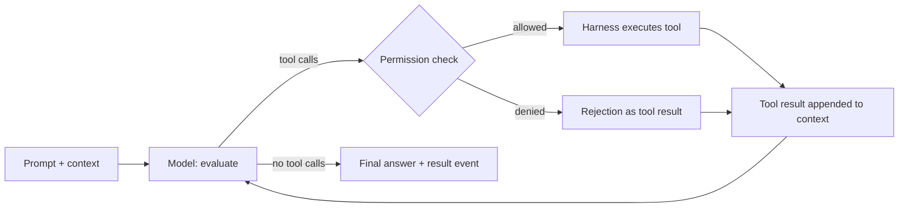

# Module 1: The agent loop and the harness

Verified against the Claude Code docs for v2.1.306 (Oct 2026): "How the agent loop works", "Choose a permission mode", "Configure permissions" and "Run Claude Code programmatically".

## 1. Concept

An AI coding agent is two things:

- **The model** (here Claude Opus) is stateless. Per call it receives the whole context (system prompt, tool definitions, CLAUDE.md, conversation, tool results) and returns text and/or tool-call requests. It never executes anything.
- **The harness** (Claude Code) does everything else: assembles the context, executes tools, enforces permissions, runs hooks, loads memory, compacts long conversations, spawns subagents, and decides when the run is over.



- **Turn:** one round trip: the model requests tools, the harness runs them, the results go back. A run ends when the model answers without requesting a tool (`stop_reason: end_turn`) or a limit stops it.
- **Parallel tool calls:** several calls in one response. Read-only tools (Read, Glob, Grep) run concurrently; tools that change state (Edit, Write, Bash) run one after another.
- **Stop conditions:** natural end (`success`), `--max-turns` (`error_max_turns`), `--max-budget-usd` (`error_max_budget_usd`), errors (`error_during_execution`), refusal (`stop_reason: refusal`), the user interrupting, or the context limit (handled by compaction, not a stop).
- **Permission check, in this order:** hooks, deny rules, ask rules, permission mode, allow rules (including calls a tool approves on its own, such as reads in the working directory and read-only Bash commands), and finally the prompt. Deny always wins; an allow rule never overrides a deny.
- **Permission modes:** `default` (shown as Manual: reads only), `acceptEdits`, `plan` (reads and read-only commands; writes only the plan file), `auto` (the default since August 2026: a classifier reviews actions instead of you), `dontAsk` (anything not pre-approved is denied; for CI), `bypassPermissions` (isolated containers only).

Phase 0 showed all of these in practice: plan mode before any code was written; parallel reads during exploration; the auto-mode classifier refusing a force push ("Git Destructive") and a change to Claude's own permissions ("Self-Modification") even with approval in chat; deny rules in `.claude/settings.json`.

## 2. Why it matters for QA

- An agent run is a test run with a trace. Reading it (turns, tool calls, denials, stop reason, cost) is the same skill as reading a Playwright trace, and the only way to debug an agent that "did something weird".
- Every turn re-sends the full context. In this repo even a one-line question costs about 44,000 context tokens per call (system prompt, 100+ tool definitions, CLAUDE.md). Turns drive cost and time.
- Headless runs have nobody to approve a prompt. What the agent may do in CI is decided entirely by the permission mode and rules you pass, so they must be designed, not defaulted.
- Stop conditions are your exit criteria. A fix loop without `--max-turns` or a budget can run, and bill, indefinitely.

## 3. Hands-on

Tooling: `npm run agent:trace -- <file>` turns a headless run into a timeline (turns, tool calls and results, denials, stop reason, cost, context size). Traces go to `traces/` (gitignored). Each run costs about $0.15 to $0.30 of usage.

For each exercise: **write down your prediction first** (number of turns, which tools, whether anything is denied, how it ends), then run it, then compare.

```bash
mkdir -p traces

# E1: a read-only question with your normal setup
claude -p "Which spec files exist under tests/api? Answer with file names only." \
  --permission-mode dontAsk --allowedTools "Glob" "Read" \
  --output-format stream-json --verbose < /dev/null > traces/e1.jsonl
npm run agent:trace -- traces/e1.jsonl

# E2a: a shell command, but only Read and Glob are allowed (MCP tools removed)
claude -p "Run node --version and tell me which Node version this machine uses." \
  --permission-mode dontAsk --allowedTools "Read" "Glob" --disallowedTools "mcp__*" \
  --output-format stream-json --verbose < /dev/null > traces/e2a.jsonl
npm run agent:trace -- traces/e2a.jsonl

# E2b: a task that needs a write, same permissions
claude -p "Create an empty file named agent-check.txt in the repository root." \
  --permission-mode dontAsk --allowedTools "Read" "Glob" --disallowedTools "mcp__*" \
  --output-format stream-json --verbose < /dev/null > traces/e2b.jsonl
npm run agent:trace -- traces/e2b.jsonl

# E3: a multi-step task with a turn limit
claude -p "Count the test() calls in every spec file under tests/e2e, reading the files one at a time." \
  --permission-mode dontAsk --allowedTools "Read" "Glob" "Grep" --disallowedTools "mcp__*" \
  --max-turns 2 --output-format stream-json --verbose < /dev/null > traces/e3.jsonl
echo "exit code: $?"
npm run agent:trace -- traces/e3.jsonl

# E4: an edit request in plan mode
claude -p "Add the line '<!-- hello -->' at the very top of README.md." \
  --permission-mode plan --disallowedTools "mcp__*" \
  --output-format stream-json --verbose < /dev/null > traces/e4.jsonl
npm run agent:trace -- traces/e4.jsonl
git status --short README.md
```

Questions to answer from the traces:

1. E1 vs E2a: how many tools and MCP servers were loaded, and how large was the context of the first call? What explains the difference?
2. E2a: only Read and Glob were allowed in `dontAsk` mode. Did the shell command run? Which step of the permission order decided that?
3. E2b: what did Claude do after the first denial? What is the result `subtype`, and does it mean the task succeeded?
4. E3: what is the result `subtype`, the exit code, and is there a final answer?
5. E4: which tools ran, what was written, and where? Is README.md changed?

### What the runs showed (2026-10-22)

| Run | Turns (model responses)   | Tools                                                        | Denials         | Result                               | Task done      |
| --- | ------------------------- | ------------------------------------------------------------ | --------------- | ------------------------------------ | -------------- |
| E1  | 2                         | Glob                                                         | 0               | `success`, exit 0                    | yes            |
| E2a | 3                         | Bash (`node --version`), Read (`.nvmrc`)                     | 0               | `success`, exit 0                    | yes            |
| E2b | 4                         | Bash (`touch`), Glob, Write                                  | 2 (Bash, Write) | `success`, exit 0                    | **no**         |
| E3  | 2 (`num_turns` reports 3) | Glob, Read                                                   | 0               | `error_max_turns`, exit 1, no answer | **no**         |
| E4  | 3 (`num_turns` reports 4) | Read x2 in parallel, Write (plan file in `~/.claude/plans/`) | 0               | `success`, exit 0                    | no (plan only) |

Predictions made before the runs, and what they got wrong:

- **"A turn is the whole run."** A turn is one model round trip. Even E1 needs two: one to call Glob, one to answer.
- **"`--allowedTools` is the tool set; `--disallowedTools` shows up as denials."** Allowed tools are only auto-approved; every other tool stays available (E2a ran Bash). Bare-name deny rules remove tools from the context before any check, so they never appear in `permission_denials`.
- **"The task will get done."** In three of five runs it did not: denied writes (E2b), a turn limit (E3) and plan mode (E4) all stopped the work, and two of those still reported `success`.

Observed details worth keeping:

- Read-only shell commands are approved by the Bash tool itself (step 5 of the permission order), so `node --version` ran in `dontAsk` without an allow rule. A compound command like `ls ... || touch ...` is judged by its parts, and `touch` is not read-only, so it was denied.
- After a denial, the rejection text tells Claude it may try a natural alternative or stop and explain. In E2b it tried Write once, was denied again, and reported honestly.
- On `error_max_turns` the last requested tool still ran; the harness only refused the next model call. In a run that writes, the last write still happens.
- `num_turns` was one higher than the number of model responses whenever the run ended normally after tools or hit the limit; treat it as approximate.
- `--disallowedTools "mcp__*"` hides MCP tools (135 to 29) but the servers still start and connect (Gmail and Drive included). Only `--bare` skips them.
- Headless plan mode cannot leave planning: `ExitPlanMode` was not loaded and there is nobody to approve. It always ends with a plan, never a change.
- The run read a memory file from `~/.claude/projects/.../memory/` on its own: memory and CLAUDE.md shape headless runs too.

Hypotheses from the analysis that were checked against the traces:

- _Refuted:_ "Glob and Grep were only loaded because `--allowedTools` named them." E2a named only Read and Glob, and Grep was loaded anyway. E4 is the only run without Glob/Grep and also the only plan-mode run, so plan mode is the likelier cause (unconfirmed: E4 differs in two ways).
- _Incomplete:_ "Node 20 because a non-interactive shell never runs `nvm use`." True, but the actual source was a stale PATH: VS Code had been started before `~/.zshrc` was fixed, and every terminal and agent it launched inherited `node@20`. A clean login shell finds no Node at all; an interactive one finds Node 24.
- _Plausible, unverified:_ MCP tools are deferred (only names in context), which would explain why removing 106 tools saved only about 2,900 tokens.

## 4. Tradeoffs and pitfalls

- **Autonomy vs oversight.** `auto` removes prompt fatigue, but its classifier is a model too: in Phase 0 it blocked a force push you had explicitly approved. Safe, but not predictable. For CI, prefer `dontAsk` with an exact allowlist, so behavior is deterministic and reviewable.
- **Cost scales with turns times context.** Remove what a task does not need (`--disallowedTools "mcp__*"`, `--bare`), and cap runs with `--max-turns` and `--max-budget-usd`.
- **Ambient tools are attack surface.** Your user-level MCP servers (here Gmail, Google Drive, Atlassian) load into every run in this repo. A task that reads untrusted text (a web page, a CI log, a PR comment) could be steered by prompt injection into using them. Least privilege: only the tools the task needs.
- **`success` is not task success.** It means the loop ended normally. A run where every write was denied still reports `success`. Scripts must check `permission_denials` and validate the output.
- **Read-only commands are pre-approved.** `dontAsk` with a strict allowlist still lets read-only shell commands run. Good for productivity, but know it when you reason about what a "locked-down" run can see.

## 5. Interview angle

- **"How does an AI coding agent work under the hood?"** A loop: the model receives the full context and returns either an answer or tool-call requests; the harness checks permissions, executes the tools, appends the results and calls the model again, until the model answers without tools or a limit (turns, budget) stops it. The model is stateless; memory, tools, safety and limits are the harness's job.
- **"How would you run an agent safely in CI?"** Non-interactive mode with `dontAsk` and an exact tool allowlist, deny rules for anything dangerous, `--max-turns` and `--max-budget-usd`, no ambient MCP servers (`--bare` or `--disallowedTools "mcp__*"`), a read-only token, secrets only where needed, an isolated runner, and a human reviewing what it produces. Check the result subtype, the denials and the output, never just the exit code.
- **"What is the difference between plan mode and asking the model to plan?"** Asking is a request the model may ignore. Plan mode is enforced by the harness: write tools cannot run (only the plan file), so nothing changes until a human approves.

## 6. Checkpoint

Answer in your own words:

1. A CI job runs `claude -p` with `--max-turns 5` and gets result subtype `error_max_turns`. What happened, is there a final answer, and what are two reasonable fixes?
2. Why could the agent not force-push in Phase 0 even after you approved it in chat, and which layer made that decision?
3. Write the flags for a headless run that may only read files and run `npm run test:api`, must not use MCP tools, and must stop after 10 turns or $1.
4. In E2b the run reported `success`. What would your CI script check instead?
